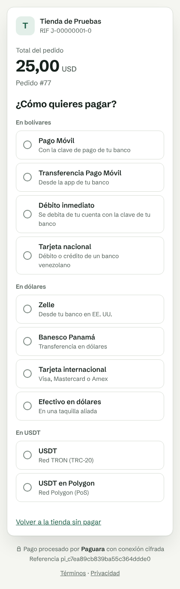
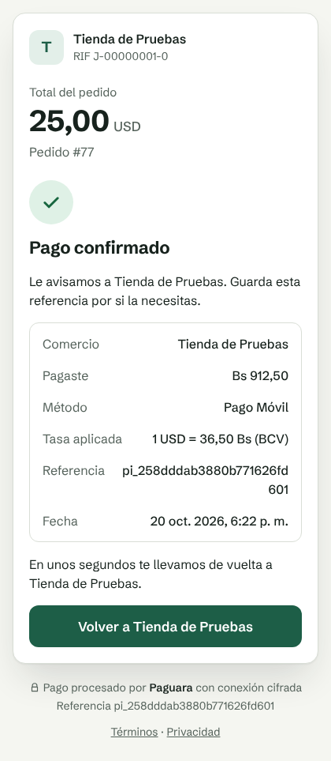

# Plugin de WooCommerce

Código: `integraciones/woocommerce/paguara-woocommerce/`. Versión 0.1.0, PHP 7.4 o más, WooCommerce 8 o más,
sin dependencias. Agrega el método de pago **Paguara**, que redirige al checkout alojado y marca el pedido como
pagado cuando la API lo confirma. Patrón general en [README.md](README.md).

## Archivos

| Archivo | Qué hace |
|---|---|
| `paguara-woocommerce.php` | Cabecera del plugin; registra el método, declara compatibilidad con HPOS y con el checkout de bloques |
| `includes/class-wc-gateway-paguara.php` | `WC_Gateway_Paguara`: ajustes, disponibilidad, `process_payment()` y la ruta `/?wc-api=paguara` |
| `includes/class-paguara-payment-flow.php` | El flujo, sin WordPress: `start()`, `handle_return()`, `handle_webhook()` y `sync()` |
| `includes/class-paguara-client.php` | Cliente de la API v1 (`wp_remote_request` por defecto; transporte inyectable en pruebas) |
| `includes/class-paguara-signature.php` | Verificación de `Webhook-Signature` (HMAC-SHA256 de `"<t>.<cuerpo>"`, tolerancia 300 s) |
| `includes/class-paguara-amount.php` | Total de WooCommerce (`"12.50"`) a unidades mínimas (`"1250"`) con texto, sin float |
| `includes/class-paguara-blocks-support.php`, `assets/js/paguara-blocks.js` | Registro en el checkout de bloques (sin compilación) |
| `tests/` | Pruebas sin WordPress (`run.php`) y la de punta a punta contra la API (`e2e.php`) |

## Flujo

**Pagar** (`process_payment` → `Paguara_Payment_Flow::start`):

- La moneda de la tienda debe ser VES, USD, EUR o USDT; si no, el método no aparece.
- Si el pedido ya tiene un pago abierto (`requires_payment_method`, `requires_confirmation`, `requires_action`
  o `processing`) con el mismo monto, moneda y entorno, se reutiliza. Si no, crea uno nuevo.
- `Idempotency-Key: wc-<sitio>-<pedido>-<intento>`: un doble clic devuelve el mismo pago. `<sitio>` son 8
  caracteres del hash de `home_url()`, para dos tiendas en la misma cuenta.
- Cuerpo: `amount`, `currency`, `return_url` = `/?wc-api=paguara&order_id=<id>&key=<order_key>`,
  `metadata` = `{source: 'woocommerce', order_id, order_number, description: 'Pedido #N'}` y `customer` con correo y nombre.
- Guarda en el pedido `_paguara_payment_intent`, `_paguara_attempt`, `_paguara_amount`, `_paguara_currency`
  y `_paguara_livemode`, agrega una nota y redirige a `<URL de la API>/checkout?pi=…&cs=…&pk=…`.

**Regreso** (`GET /?wc-api=paguara`): exige la llave del pedido (`hash_equals`), consulta el pago con la llave
secreta y aplica `sync()`. Pagado o en espera → “pedido recibido”. Cancelado o vencido → carrito con aviso.
Sin pagar → página de pago del pedido con aviso. Ignora `redirect_status`: lo pone el navegador.

**Webhook** (`POST /?wc-api=paguara`):

| Caso | Respuesta |
|---|---|
| Firma inválida o `t` con más de 300 s | 400 (Paguara reintenta) |
| Evento que no es `payment_intent.*`, de otro entorno, sin `metadata.source = woocommerce`, de un pedido inexistente o de un pago que ya no es el del pedido | 200 sin cambios |
| La API no responde al consultar el pago | 500 (Paguara reintenta con su espera exponencial) |
| Resto | Consulta el pago y aplica `sync()`; 200 |

**`sync()`** solo actúa si el id, el monto, la moneda y el entorno coinciden con lo guardado en el pedido (si no,
deja una nota y no cambia nada). Es idempotente.

| Estado del pago | Pedido |
|---|---|
| `succeeded`, `settled` | `payment_complete(<pi>)` (descuenta inventario y pasa a *Procesando*) y nota con lo cobrado |
| `processing` | De *Pendiente* a *En espera* |
| `canceled` | De *Pendiente*, *En espera* o *Fallido* a *Cancelado*, con el motivo |
| Otros | Sin cambios (el pagador todavía puede pagar) |

## Ajustes

*WooCommerce → Ajustes → Pagos → Paguara*: activar, título, descripción, **modo pruebas** (por defecto sí), y para
cada entorno la URL de la API, la llave secreta, la publicable y el secreto del webhook. El sandbox y producción son
despliegues distintos (`LIVEMODE`), por eso cada uno tiene su URL. El método solo aparece si las llaves son del
entorno elegido (`sk_test_`/`pk_test_` o `sk_live_`/`pk_live_`). El registro opcional (fuente `paguara`) nunca
guarda llaves.

El comercio crea el webhook en el panel de Paguara (Desarrolladores → Webhooks) con la URL que muestra el ajuste,
`https://<tienda>/?wc-api=paguara`, y pega el `whsec_`.

## Instalar

```
cd integraciones/woocommerce
zip -r paguara-woocommerce.zip paguara-woocommerce -x 'paguara-woocommerce/tests/*'
```

Y en WordPress: *Plugins → Añadir nuevo → Subir plugin*.

## Pruebas

- `php integraciones/woocommerce/paguara-woocommerce/tests/run.php`: 13 pruebas sin WordPress, con un pedido y una API
  falsos (montos, firma, creación y reutilización del pago, webhook, regreso, `sync`). Corre en CI (job `woocommerce`),
  junto con `php -l` de cada archivo.
- `tests/e2e.php`: de punta a punta contra una API real. Crea el pago como el plugin, carga la página del checkout,
  paga con Pago Móvil C2P en el sandbox, recibe el webhook firmado en un `php -S` local y revisa que el pedido quedó
  pagado. No corre en CI. Para correrlo en local:

```
# API en sandbox con WEBHOOK_ALLOW_HTTP=true y WEBHOOK_ALLOW_PRIVATE=true, tasas cargadas (dev-jobs) y el seed.
# Crear en el panel un webhook a http://127.0.0.1:8099/ con todos los eventos.
PAGUARA_API_URL=http://localhost:3000 PAGUARA_SECRET_KEY=sk_test_… PAGUARA_PUBLISHABLE_KEY=pk_test_… \
PAGUARA_WEBHOOK_SECRET=whsec_… php integraciones/woocommerce/paguara-woocommerce/tests/e2e.php
```

No se probó dentro de un WordPress real: la clase del método (`WC_Gateway_Paguara`) y el registro de bloques solo
pasan `php -l`. **Pendiente** antes de entregarlo a un comercio: probarlo en WordPress con WooCommerce en checkout
clásico y de bloques.

## Límites

- Sin reembolsos desde WooCommerce: la API no tiene endpoint de reembolsos (`supports = ['products']`).
- Sin suscripciones ni pagos guardados.
- El total del pedido no puede tener más decimales que la moneda (no se redondea en silencio).

## Capturas



